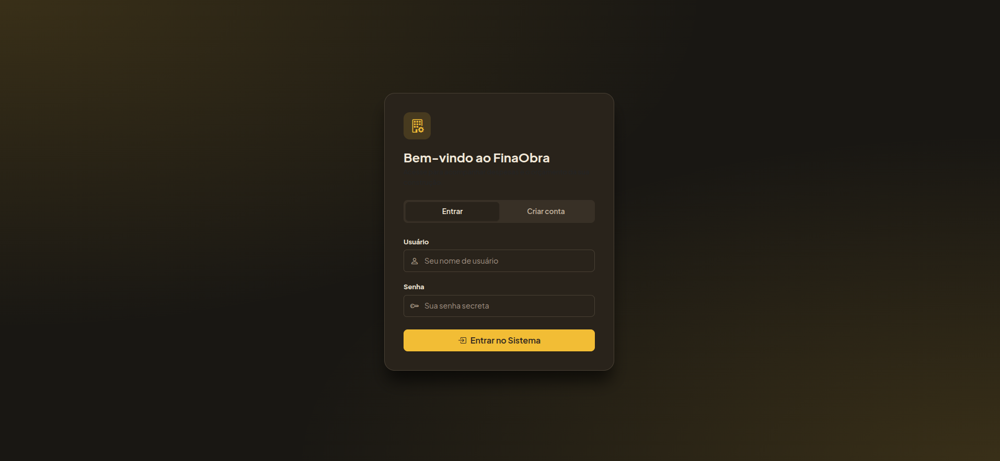
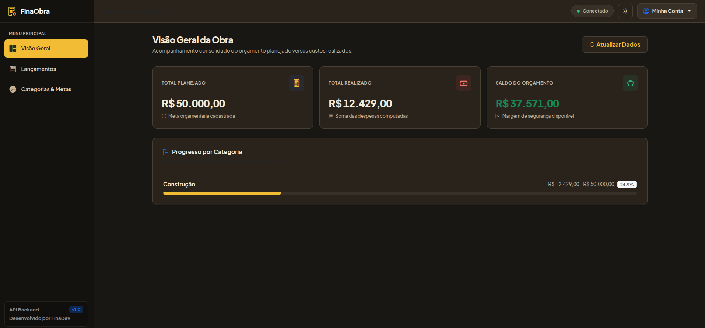
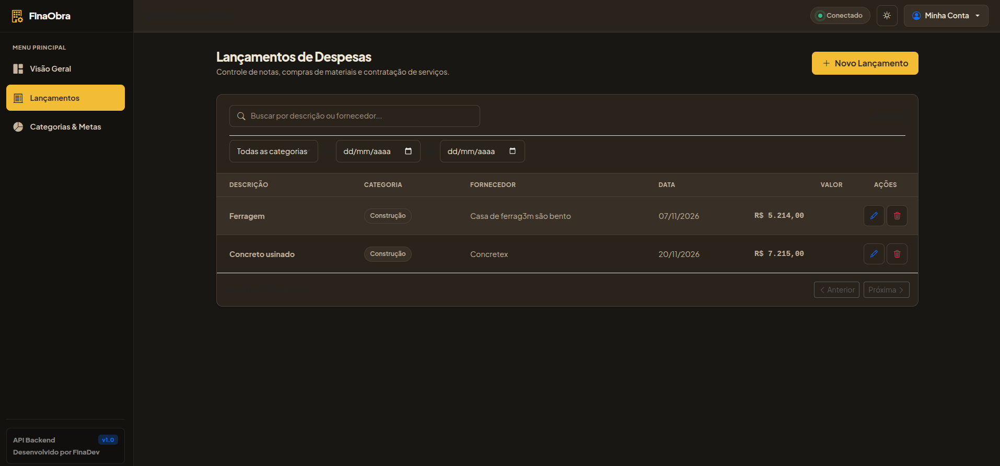
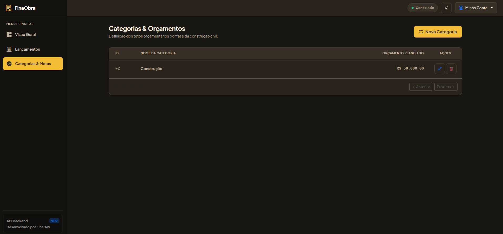
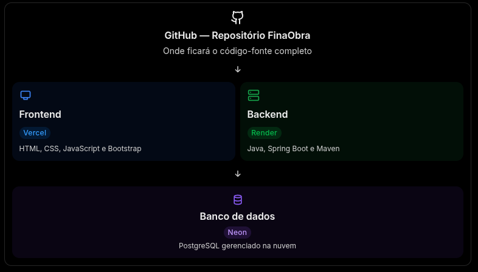

# FinaObra

**Sistema web para gerenciamento de orçamentos e despesas durante a construção de imóveis.**

O FinaObra é uma aplicação desenvolvida para auxiliar no planejamento e controle financeiro de obras residenciais, permitindo organizar categorias de despesas, estabelecer orçamentos e acompanhar os valores efetivamente gastos.

**Aplicação em produção:** [Acessar FinaObra](https://finaobra-frontend.vercel.app)

---

## 1. Sobre o projeto

O FinaObra surgiu a partir da identificação de um problema real: a dificuldade de manter o controle financeiro durante a construção de um imóvel.

A ideia nasceu ao acompanhar a experiência de um companheiro que, durante a construção da própria casa, enfrentou dificuldades para administrar os orçamentos e as despesas da obra. A falta de acompanhamento financeiro contribuiu para que os gastos ultrapassassem o planejamento inicial, ocasionando endividamento.

A partir dessa situação, desenvolvi o FinaObra com o objetivo de oferecer uma ferramenta simples e acessível para auxiliar na organização financeira da construção.

A aplicação foi projetada com foco na simplicidade de uso, priorizando funcionalidades essenciais para o controle dos recursos financeiros, sem adicionar complexidade desnecessária ao processo de gerenciamento.

O projeto foi desenvolvido, implantado e disponibilizado em produção, atendendo à necessidade que motivou sua criação.

## 2. Demonstração da aplicação

Confira o funcionamento da aplicação:

**Vídeo demonstrativo:** [Assistir à demonstração do FinaObra](LINK_DO_VIDEO)

### Interface da aplicação

#### Login

Autenticação de usuários e possibilidade de criação de uma nova conta.



#### Dashboard

Visão consolidada do planejamento financeiro e das despesas realizadas.



#### Gerenciamento de despesas

Registro, consulta e gerenciamento das despesas da construção.



#### Gerenciamento de Categorias

Organização das categorias e definição dos respectivos orçamentos.



## 3. Funcionalidades

- **Autenticação de usuários:** autenticação e autorização utilizando Spring Security e JWT.
- **Gerenciamento de categorias:** criação, consulta, atualização e exclusão de categorias.
- **Planejamento financeiro:** definição de valores planejados para cada categoria.
- **Controle de despesas:** registro e gerenciamento dos gastos realizados durante a construção.
- **Dashboard financeiro:** consolidação dos valores planejados, realizados e saldo disponível.
- **Isolamento de dados:** cada usuário possui acesso exclusivamente aos próprios registros.
- **Interface responsiva:** utilização de recursos do Bootstrap para adaptação a diferentes dispositivos.

## 4. Tecnologias e ferramentas

### Backend

| Tecnologia | Aplicação |
| --- | --- |
| Java | Linguagem de programação |
| Spring Boot | Framework para desenvolvimento da API REST |
| Spring Security | Autenticação e autorização |
| JWT | Gerenciamento de autenticação baseada em tokens |
| Spring Data JPA | Persistência e acesso aos dados |
| PostgreSQL | Banco de dados relacional |
| Flyway | Versionamento e migração do banco de dados |
| Swagger / OpenAPI | Documentação e exploração dos endpoints |
| Hazelcast | Gerenciamento de cache distribuído |
| Bucket4j | Controle de limite de requisições (Rate Limiting) |

### Frontend

| Tecnologia | Aplicação |
| --- | --- |
| HTML5 | Estrutura da aplicação |
| CSS3 | Estilização e responsividade |
| JavaScript | Comportamento e integração com a API |
| Bootstrap | Componentes e recursos de interface responsiva |

### Infraestrutura e deploy

| Serviço | Responsabilidade |
| --- | --- |
| Vercel | Hospedagem do frontend |
| Render | Hospedagem da API REST |
| Neon | Banco de dados PostgreSQL gerenciado |

## 5. Segurança e controle de acesso

A aplicação implementa mecanismos de segurança para proteger os recursos e garantir a separação dos dados entre os usuários.

Principais recursos implementados:

- Autenticação baseada em JWT.
- Configuração de filtros e regras de autorização com Spring Security.
- Proteção dos endpoints da API.
- Controle de acesso aos registros associado ao usuário autenticado.
- Configuração de CORS para comunicação entre frontend e backend.
- Rate Limiting utilizando Bucket4j e Hazelcast.
- Gerenciamento de alterações estruturais do banco de dados com Flyway.

## 6. Arquitetura e infraestrutura

#### Desenho da Arquitetura



A aplicação utiliza uma arquitetura cliente-servidor, na qual o frontend realiza requisições HTTP para a API REST, responsável pelas regras de negócio, autenticação, autorização e persistência dos dados.

A comunicação entre os componentes ocorre por meio de endpoints REST, utilizando JSON para troca de informações.

### Ambiente de produção

- Frontend hospedado na Vercel.
- Backend hospedado no Render.
- Banco de dados PostgreSQL hospedado no Neon.

A solução utiliza serviços gerenciados em nuvem, reduzindo a necessidade de administração direta de servidores e infraestrutura própria.

## 7. Documentação da API

A API possui documentação gerada com Swagger / OpenAPI, permitindo consultar os endpoints disponíveis, visualizar os contratos de requisição e resposta e realizar testes das operações.

**Documentação em Dev:** [Acessar Swagger](http://localhost:8080/swagger-ui/index.html)

**Documentação em Prod:** [Acessar Swagger](https://finaobra.onrender.com/swagger-ui/index.html)

## 8. Execução local

### Pré-requisitos

- Java 21 ou superior.
- Maven.
- Banco de dados MySQL ou PostgreSQL, conforme a configuração da aplicação.
- Git.

### 8.1 Clonando o repositório

```bash
git clone URL_DO_REPOSITORIO
cd FinaObra
```

### 8.2 Configurando as variáveis de ambiente

A aplicação utiliza variáveis de ambiente para configurar a conexão com o banco de dados e a chave de assinatura dos tokens JWT.

**Linux (Bash / Zsh)**

Adicione as variáveis ao arquivo `~/.bashrc`:

```bash
echo 'export USER_DB="nome_usuario"' >> ~/.bashrc
echo 'export PASSWORD_DB="senha_banco"' >> ~/.bashrc
echo 'export URL_DB="jdbc:postgresql://localhost:5432/seu_banco"' >> ~/.bashrc
echo 'export SECURITY_SECRET_TOKEN="sua_chave_jwt"' >> ~/.bashrc
```

Aplique as alterações:

```bash
source ~/.bashrc
```

**Windows (PowerShell)**

```powershell
[Environment]::SetEnvironmentVariable("USER_DB", "nome_usuario", "User")
[Environment]::SetEnvironmentVariable("PASSWORD_DB", "senha_banco", "User")
[Environment]::SetEnvironmentVariable("URL_DB", "jdbc:postgresql://localhost:5432/seu_banco", "User")
[Environment]::SetEnvironmentVariable("SECURITY_SECRET_TOKEN", "sua_chave_jwt", "User")
```

Após configurar as variáveis, reinicie o terminal ou a IDE para que as alterações sejam reconhecidas.

### 8.3 Gerando a chave JWT

Gere uma chave aleatória e segura para utilizar na variável `SECURITY_SECRET_TOKEN`.

**Linux**

```bash
openssl rand -base64 32
```

**Windows (PowerShell)**

```powershell
$bytes = New-Object byte[] 32
$rng = [System.Security.Cryptography.RandomNumberGenerator]::Create()
$rng.GetBytes($bytes)
[Convert]::ToBase64String($bytes)
$rng.Dispose()
```

Copie o valor gerado e configure na variável `SECURITY_SECRET_TOKEN`.

### 8.4 Executando a aplicação

Com as variáveis de ambiente configuradas e o banco de dados disponível, execute:

```bash
./mvnw spring-boot:run
```

No Windows, utilize:

```powershell
.\mvnw.cmd spring-boot:run
```

As configurações de conexão com o banco de dados e demais parâmetros da aplicação devem ser definidos por meio de variáveis de ambiente.

Consulte as configurações do projeto para preencher as variáveis de ambiente necessárias antes da inicialização.

### Configuração das variáveis de ambiente PARA IDE

Na raiz do projeto, crie um arquivo chamado `.env`.

Utilize o arquivo `.env.example` como referência e configure
as variáveis necessárias para a execução da aplicação.

Exemplo:

```env
USER_DB=seu_usuario
PASSWORD_DB=sua_senha
URL_DB=sua_url_de_conexao
SECURITY_SECRET_TOKEN=sua_chave_secreta
```

OSB: Aponte esse arquivo .`.env` para dentro da sua IDE.

## 9. Objetivos e aprendizados técnicos

O desenvolvimento do FinaObra proporcionou a aplicação prática de conceitos importantes para o desenvolvimento Backend, incluindo:

- Construção e organização de APIs REST.
- Implementação de autenticação e autorização com Spring Security e JWT.
- Controle de acesso e isolamento de dados por usuário.
- Persistência de dados relacionais com Spring Data JPA.
- Versionamento de banco de dados com Flyway.
- Implementação de Rate Limiting com Bucket4j e Hazelcast.
- Configuração de CORS e integração entre aplicações.
- Documentação de APIs com Swagger / OpenAPI.
- Configuração e publicação de aplicações em ambientes de produção.

---

## Autor

**Vitor Fidelis**

[GitHub](https://github.com/VitorFidelis)
 | [Linkedin](https://www.linkedin.com/in/vitor-fideliss/)
